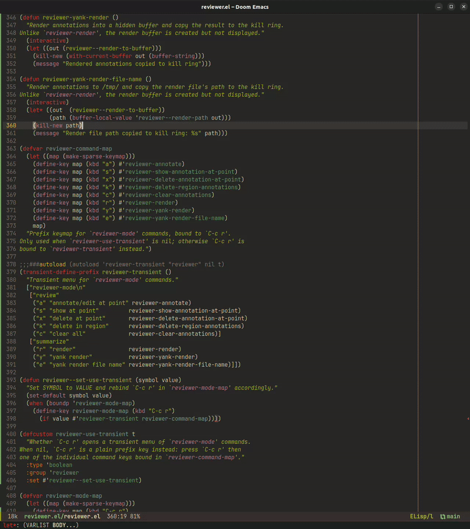

#+TITLE: reviewer.el

reviewer.el is a minor mode for annotating a file, diff, or any Emacs
buffer without changing its content. Annotate a region or word, reply
to build a thread, and render a buffer's (or a whole project's)
annotations as a plain org document for your own reference or to hand
off to an agent (for example, [[https://github.com/xenodium/agent-shell][agent-shell]]) working on the same code.
An optional treemacs sidebar lets you browse every thread across your
buffers in one place.

https://github.com/user-attachments/assets/99aa946f-55a2-444f-8cae-292e24cfb378

* Usage

- ~reviewer-annotate~ :: Annotate the active region (or word at
  point), or edit the note on an existing annotation at point. A
  small =*reviewer-annotation*= buffer pops up to edit the note text:
  finish editing to save it (clearing the text deletes the annotation
  instead), or abort to cancel.
- ~reviewer-reply-to-annotation~ :: Reply to the annotation thread at
  point, in the same kind of edit buffer as ~reviewer-annotate~. An
  empty reply is dropped instead of appended.
- ~reviewer-show-annotation-at-point~ :: Show the annotation at point
  in a posframe (author, time, note, and any replies), until the next
  command. Falls back to the echo area if [[https://github.com/tumashu/posframe][posframe]] isn't installed.
- ~reviewer-delete-annotation-at-point~ :: Delete the annotation at
  point.
- ~reviewer-delete-region-annotations~ :: Delete all annotations
  overlapping the active region, after confirming.
- ~reviewer-clear-annotations~ :: Delete all annotations in the
  current buffer, after confirming.
- ~reviewer-clear-project-annotations~ :: Delete all annotations in
  every annotated buffer in the current project, after confirming.
  The project is found with [[https://github.com/bbatsov/projectile][Projectile]] if it's installed and active, or
  with Emacs's built-in ~project.el~ otherwise.

  These three bulk-delete commands prompt with ~y-or-n-p~ before
  deleting, since the delete isn't undoable. Set
  ~reviewer-confirm-before-clear~ to ~nil~ to skip the prompt.
- ~reviewer-render~ :: Render all annotations in the buffer as an org
  file in =/tmp/=, displayed in a =*reviewer:file*= buffer.
  ~reviewer-render-next-annotation~ and
  ~reviewer-render-previous-annotation~ move between entries there.
- ~reviewer-yank-render~ :: Render annotations and copy the result to
  the kill ring, without displaying the render buffer.
- ~reviewer-yank-render-file-name~ :: Render annotations to =/tmp/=
  and copy the render file's path to the kill ring.
- ~reviewer-render-project~, ~reviewer-yank-render-project~,
  ~reviewer-yank-render-project-file-name~ :: The same three render
  commands, but across every annotated buffer in the current project
  instead of just the current one. The project is found with
  [[https://github.com/bbatsov/projectile][Projectile]] if it's installed and active, or with Emacs's built-in
  ~project.el~ otherwise.

All of the above are ordinary interactive commands: call them with
~M-x~, or bind them to whatever keys you prefer.

Each rendered entry leads with the annotated span as a source block,
then a ~threadId:~ line and one ~author (time): text~ line per
participant -- the note, then each reply, oldest first -- as a short
digest of the thread before you go read it in full elsewhere.

** Transient menu

reviewer-mode binds a default prefix key that opens a transient menu
(via [[https://github.com/magit/transient][transient]]) listing all of the commands above, in three columns:
"review" (annotation commands), "buffer" (render commands for the
current buffer), and "project" (project-wide render and clear commands).
Set ~reviewer-use-transient~ to ~nil~ to make that prefix a plain keymap
instead, dispatching straight to each command with no menu shown.

* The treemacs tree/detail view

reviewer-treemacs.el adds an optional sidebar: a tree of every
annotation thread across your buffers, docked to one side of the
frame, with a detail pane underneath showing the selected thread's
full text. Where the posframe popup shows one annotation at a time,
this is a persistent view for browsing all of them.

It's a separate feature, off by default, since treemacs is a heavier
dependency than the mode's other optional integrations. Turn it on
with:

#+BEGIN_SRC emacs-lisp
(setopt reviewer-enable-treemacs t)
#+END_SRC

or a ~:custom~ entry in ~use-package~ (see the sample configuration
below). Turning it on loads ~reviewer-treemacs~ and adds a "t" suffix
to the transient menu for ~reviewer-treemacs-toggle~.

** Usage

- ~reviewer-treemacs-toggle~ :: Open the tree/detail pane if it isn't
  showing. If it's already showing, switch focus to it; if a window of
  the pane is already selected, close it instead. Also bound to ~q~
  and ~C-g~ in both panes, so those always close it from inside.
- ~n~ / ~p~ :: Move to the next or previous thread, skipping over file
  headers.
- ~RET~ :: Jump to the thread's source and show it there (highlight
  and popup), without leaving the tree pane selected, so ~n~/~p~ keep
  driving straight through a string of threads. Set
  ~reviewer-treemacs-ret-moves-focus~ to switch focus there instead,
  matching ~o o~ below.
- ~o o~ :: Jump to the thread's source and switch focus there.
- ~o v~ / ~o h~ :: The same, opened in a fresh vertical or horizontal
  split.
- ~o c~ :: Jump to the thread's source, then close the tree/detail
  pane.
- ~r~ :: Open a small reply pane, stacked below the detail pane, to
  reply to the thread at point.

The tree rebuilds itself whenever an annotation is created, edited,
replied to, or deleted anywhere -- not just through this pane's own
commands -- so it never needs a manual refresh.

** Configuration

- ~reviewer-treemacs-side~ :: Which side of the frame the pane docks
  to, ~left~ or ~right~.
- ~reviewer-treemacs-width~ :: Width of the pane: an integer for a
  column count, or a float for a fraction of the frame's width.
- ~reviewer-treemacs-slot~ :: Which side-window slot the pane
  occupies. Change this if it collides with another package's side
  window on the same side; see the variable's docstring for why that
  can happen.
- ~reviewer-treemacs-summary-length~ :: How many characters a
  thread's tree label is truncated to.
- ~reviewer-treemacs-ret-moves-focus~ :: Whether ~RET~ switches focus
  to a thread's source, as described above.

* Installation

** straight.el and use-package

#+BEGIN_SRC emacs-lisp
(use-package reviewer
  :straight (reviewer :type git :host github :repo "SreenivasVRao/reviewer.el")
  :hook (after-init . reviewer-global-mode))
#+END_SRC

~reviewer-global-mode~ turns on ~reviewer-mode~ in every buffer; hook
it to a single major mode instead if you'd rather opt in per-buffer.

For a local checkout instead of pulling from GitHub, use
~:local-repo~:

#+BEGIN_SRC emacs-lisp
(use-package reviewer
  :straight (reviewer :type git :local-repo "/path/to/reviewer.el")
  :hook (after-init . reviewer-global-mode))
#+END_SRC

The treemacs tree/detail view needs [[https://github.com/Alexander-Miller/treemacs][treemacs]] too, since
~reviewer-treemacs.el~ isn't loaded unless you turn it on:

#+BEGIN_SRC emacs-lisp
(use-package reviewer
  :straight (reviewer :type git :host github :repo "SreenivasVRao/reviewer.el")
  :hook (after-init . reviewer-global-mode)
  :custom
  (reviewer-enable-treemacs t))
#+END_SRC

** Doom Emacs

In =packages.el=:

#+BEGIN_SRC emacs-lisp
(package! reviewer
  :recipe (:host github :repo "SreenivasVRao/reviewer.el"))
#+END_SRC

In =config.el=:

#+BEGIN_SRC emacs-lisp
(use-package! reviewer
  :hook (after-init . reviewer-global-mode))
#+END_SRC

** Configuration

reviewer.el exposes these knobs, all under the ~reviewer~ customize
group. See [[*The treemacs tree/detail view][the treemacs section above]] for the knobs specific to
that view.

- ~reviewer-highlight-face~ :: Face for the annotated region.
- ~reviewer-posframe-face~, ~reviewer-posframe-border-face~,
  ~reviewer-posframe-author-face~, ~reviewer-posframe-time-face~ ::
  Faces for the body, border, and header (author/time) of the
  posframe shown by ~reviewer-show-annotation-at-point~.
- ~reviewer-posframe-parameters~ :: A plist controlling the
  posframe's geometry: ~:border-width~, ~:fringe~ (the blank margin
  left and right, in pixels -- the same idea as a window's fringe),
  ~:width~ (fixed width in characters -- long notes wrap instead of
  widening the frame), and ~:min-height~ (lines).
- ~reviewer-use-transient~ :: Whether the default prefix key opens
  the transient menu (see above) or a plain keymap.
- ~reviewer-confirm-before-clear~ :: Whether
  ~reviewer-clear-annotations~, ~reviewer-clear-project-annotations~,
  and ~reviewer-delete-region-annotations~ prompt for confirmation
  before deleting. Defaults to ~t~; set to ~nil~ to delete immediately.
- ~reviewer-annotation-edit-buffer-action~ :: Where the note-editing
  buffer from ~reviewer-annotate~ pops up.
- ~reviewer-enable-treemacs~ :: Whether to load the treemacs
  tree/detail view; see above.
- ~reviewer-annotation-change-hook~ :: Runs after an annotation is
  created, edited, replied to, or deleted, with no arguments. Hook
  your own automation into this if you want something to happen every
  time an annotation changes -- it's what the treemacs view itself
  uses to keep its tree in sync.

A full sample configuration, documenting each of these:

#+BEGIN_SRC emacs-lisp
(use-package reviewer
  :straight (reviewer :type git :host github :repo "SreenivasVRao/reviewer.el")
  :hook (after-init . reviewer-global-mode)
  :custom
  ;; Show a transient menu on the prefix key instead of a plain keymap.
  (reviewer-use-transient t)
  ;; Geometry of the posframe used to show an annotation at point.
  (reviewer-posframe-parameters '(:border-width 2 :fringe 16 :width 40 :min-height 5))
  ;; Load the treemacs tree/detail view.
  (reviewer-enable-treemacs t)
  ;; Skip the confirmation prompt before a bulk annotation delete.
  (reviewer-confirm-before-clear nil)
  :custom-face
  ;; Highlight for the annotated region itself.
  (reviewer-highlight-face ((t :inherit highlight)))
  ;; Posframe body, border, and header faces.
  (reviewer-posframe-face ((t :inherit tooltip)))
  (reviewer-posframe-border-face ((t :foreground "orange")))
  (reviewer-posframe-author-face ((t :inherit font-lock-keyword-face :weight bold)))
  (reviewer-posframe-time-face ((t :inherit font-lock-comment-face)))
  :init
  ;; Pop the note-editing buffer up below the current window.
  (setq reviewer-annotation-edit-buffer-action
        '((display-buffer-reuse-window display-buffer-below-selected)
          (window-height . 20))))
#+END_SRC

* Status

~reviewer-mode~ (create, edit, reply to, and show annotations), the
org renderer (single-buffer and project-wide), and the treemacs
tree/detail view are all in place. There's no persistence across
sessions yet.

* Comparison to related packages

** forge, lgtm.el, github-review, code-review

These packages all assume the thing under review is a pull request on
a forge (GitHub, GitLab, or Bitbucket) and that the endpoint is a
remote submission -- approving, rejecting, or commenting through API
calls, backed by OAuth tokens, diff-hunk anchoring, and server-side
threaded comments. reviewer.el isn't trying to solve that problem: it's
purely for commenting on buffers -- for your own reference, and to
guide an agent while it writes or edits code.

** [[https://github.com/bastibe/annotate.el][annotate.el]]

reviewer.el is similar in spirit to annotate.el: both are built around
a region- or word-triggered, in-place-editable annotation that leaves
the file's content untouched. annotate.el additionally persists
annotations to a database across sessions; reviewer.el adds a posframe
and a treemacs sidebar for viewing annotations, and a transient menu
for discovering commands, none of which annotate.el has.
